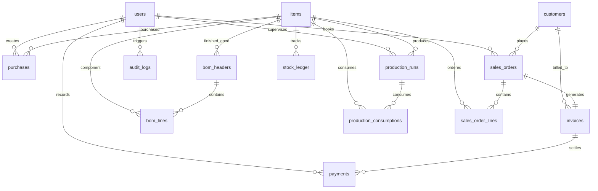

# FactoryFlow ERP — Design Note & Technical Architecture

## 1. Architecture & Relational Data Model

FactoryFlow ERP is built on clean architectural separation: a Vite + React frontend styled with Tailwind CSS, a Java 17 / Spring Boot 3 enterprise core with strict `@Transactional` ACID boundaries, and an immutable MySQL 8.0 InnoDB datastore.

---

## 2. Ledger-Based Inventory & Audit Traceability

Inventory balances are **never stored as a mutable column** on the `items` table. Instead, stock positions are derived dynamically via:

$$\text{Current Balance} = \sum \text{qty\_change} \quad (\text{from } \texttt{stock\_ledger})$$

Every stock transaction is immutable and strictly typed via `movement_type` (`OPENING`, `PURCHASE`, `PROD_ISSUE`, `PROD_WASTAGE`, `PROD_OUTPUT`, `SALE_DISPATCH`, `ADJUSTMENT`). Full bi-directional traceability is enforced through composite foreign keys `(source_type, source_id)` back to originating operational documents (`PURCHASE`, `PRODUCTION_RUN`, `INVOICE`, `INVOICE_CANCEL`).

---

## 3. BOM & Multi-Pack Extensibility

The Bill of Materials architecture uses `recipe_group` to decouple bulk master recipe formulation from retail finished packaging:
- **Bulk Ingredients**: `RM-FLOUR`, `RM-OIL`, and `RM-SPICE` form the bulk snack dough recipe (`is_packaging = false`).
- **Packaging Lines**: `PK-POUCH-200` and `PK-CARTON-20` package the base recipe into a 200 g SKU (`is_packaging = true`).
- **Extensibility**: Introducing a 500 g pouch size requires only a new item record and packaging line definitions; zero alterations are needed to the master processing formula or bulk dough kitchen logic.

---

## 4. Costing & Valuation Methodology (NIT Trichy Benchmark)

The costing engine applies **First-In, First-Out (FIFO)** raw material acquisition valuation. Damaged packaging is fully absorbed into the good output packets, and factory direct conversion expenses are allocated per batch:

$$\text{Unit Cost per Packet} = \frac{\text{Raw Material FIFO Cost} + \text{Packaging FIFO Cost} + \text{Labour} + \text{Overheads}}{\text{Actual Good Packets Produced}}$$

### Benchmark Costing Breakdown (1 Batch Murukku 200 g):

| Cost Component | Standard / Actual Quantity | Unit Rate (₹) | Total Cost (₹) | Notes |
|---|---|---|---|---|
| **Flour (`RM-FLOUR`)** | 40.000 kg | ₹42.00 / kg | **₹1,680.00** | Drawn from 100 kg opening FIFO layer |
| **Cooking Oil (`RM-OIL`)** | 10.500 L (+5% var) | ₹140.00 / L | **₹1,470.00** | Drawn from 30 L opening FIFO layer |
| **Salt & Spice Mix (`RM-SPICE`)** | 1.200 kg | ₹200.00 / kg | **₹240.00** | Drawn from 5 kg opening FIFO layer |
| **Subtotal Raw Materials** | — | — | **₹3,390.00** | Standard ±3% consumption check |
| **200 g Pouches (`PK-POUCH-200`)** | 194 pcs (188 good + 6 damaged) | ₹2.50 / pc | **₹485.00** | 6 damaged pouches absorbed in batch |
| **Cartons (`PK-CARTON-20`)** | 9 cartons | ₹15.00 / carton | **₹135.00** | Standard packaging issue |
| **Subtotal Packaging** | — | — | **₹620.00** | Absorbs packaging wastage |
| **Direct Labour Cost** | Fixed Batch Rate | — | **₹1,200.00** | Conversion expense |
| **Gas / Power Overheads** | Fixed Batch Rate | — | **₹600.00** | Factory overhead allocation |
| **Total Batch Cost** | — | — | **₹5,810.00** | For 188 actual good packets |

$$\mathbf{\text{Calculated Unit Cost}} = \frac{₹5,810.00}{188 \text{ packets}} = \mathbf{₹30.90 \text{ / packet}}$$

$$\mathbf{\text{Gross Profit Margin}} = \frac{₹50.00 - ₹30.90}{₹50.00} \times 100 = \mathbf{38.20\%}$$
